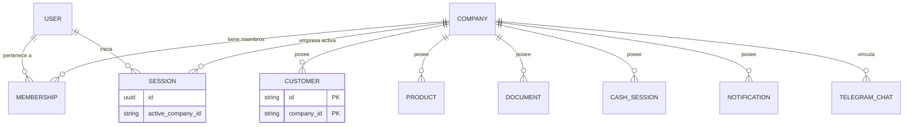
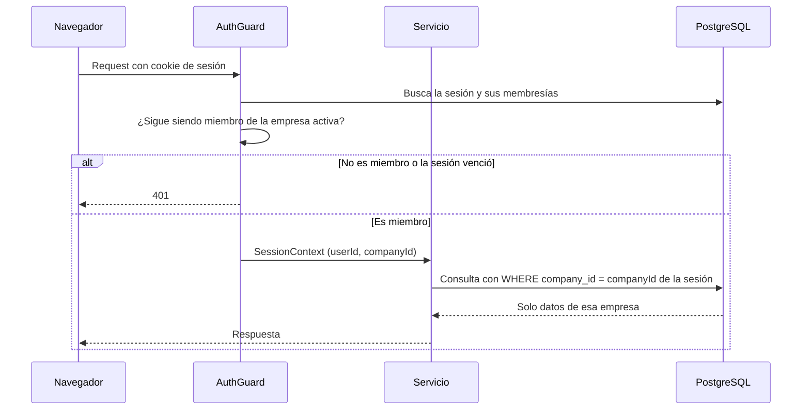
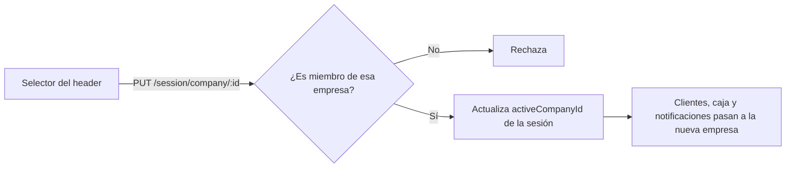

# Multi-tenant en Operia

Cada empresa (`Company`) es un tenant con sus propios datos dentro de la misma base. Un usuario puede pertenecer a varias empresas y cada sesión trabaja sobre una sola, la empresa activa.

## Modelo de datos

Las tablas de negocio usan clave compuesta `(id, companyId)`, así que el mismo `id` puede repetirse entre empresas y una consulta sin `companyId` no identifica ninguna fila.

## Qué pasa en cada pedido

El `companyId` sale de la sesión del servidor, nunca de un parámetro que mande el cliente.

## Cambiar de empresa

## Alcance del aislamiento

- El filtro por empresa es una convención del código de cada servicio. No hay row-level security en PostgreSQL.
- Los tests e2e de cada módulo verifican que una empresa no vea los datos de otra.
- `Membership` solo indica pertenencia. No hay roles ni permisos distintos por empresa.
- Los chats de Telegram se vinculan a una sola empresa, y sus pedidos llegan solo a ella.
