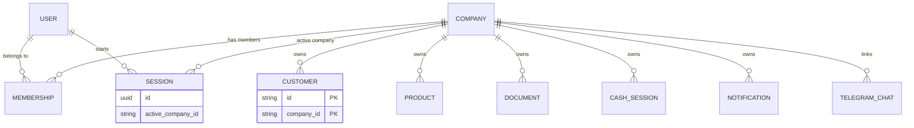
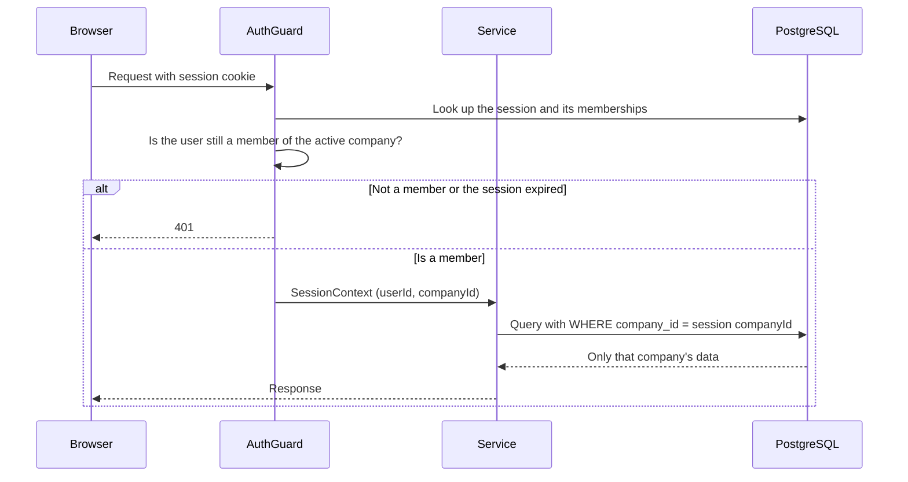
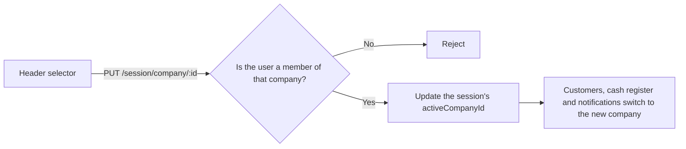

# Multi-tenancy in Operia

Each company (`Company`) is a tenant with its own data inside the same database. A user can belong to several companies, and each session works on a single one, the active company.

## Data model

Business tables use a composite key `(id, companyId)`, so the same `id` can repeat across companies and a query without `companyId` does not identify any row.

## What happens on each request

The `companyId` comes from the server-side session, never from a parameter sent by the client.

## Switching company

## Scope of the isolation

- Filtering by company is a convention in each service's code. There is no row-level security in PostgreSQL.
- The e2e tests of each module verify that one company cannot see another company's data.
- `Membership` only records belonging. Roles and permissions are managed separately; see "Roles and permissions per company" in [decisions.md](decisions.md).
- Telegram chats are linked to a single company, and their orders reach only that company.
